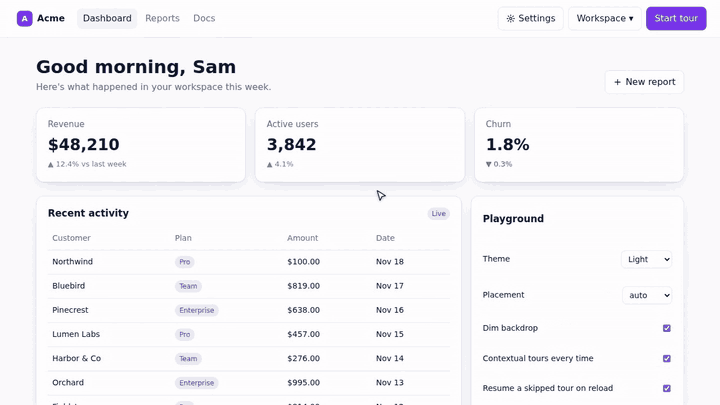
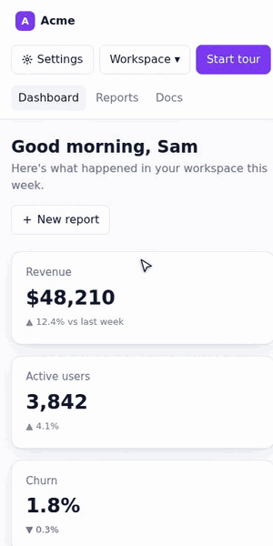

# @xkid1/tour-guide

A **zero-dependency**, accessible and responsive product-tour **Web Component**:
`<tour-guide>`. Use it to walk users through your app one step at a time: highlight an
element, explain it, move on.

It is one custom element, so it works anywhere HTML works: plain HTML, React, Vue, Svelte,
Angular, Electron, and Android / iOS / React Native WebViews.

<p align="center">
  
  
</p>

<p align="center"><sub>Desktop and mobile. Run it yourself with <code>yarn demo</code> (see <a href="demo/index.html">demo/index.html</a>).</sub></p>

- 🧩 **One custom element** with Shadow DOM: its styles never leak into your app, and
  yours never break it
- 🎛️ **Configurable three ways**: HTML attributes, a JavaScript `options` object, or CSS
  (`--tg-*` variables and `::part()`)
- 📱 **Responsive**: flips and clamps to stay on screen; on phones it becomes a
  screen-wide card that follows its target
- ✨ **Animated**: enter/exit animations, direction-aware Next/Back, smooth scrolling to
  off-screen targets
- ♿ **Accessible**: `role="dialog"`, focus trap and restore, Esc / ← / → keys, reduced
  motion, forced colours
- ⚡ **Async hooks**: open a menu, fetch data or change route before a step shows
- 🌗 Light, dark and auto themes, translatable labels, custom icons
- 🪶 About 16 KB gzipped (whole browser bundle), no runtime dependencies, SSR-safe imports

## Contents

- [Install](#install)
- [Quick start](#quick-start)
- [Core concepts](#core-concepts): steps, targets, content, navigation, lifecycle
- [Recipes](#recipes): show once, resume, menus and modals, async content, clickable
  targets, i18n…
- [Frameworks](#frameworks): React, Vue, Svelte, Angular, Electron, WebViews
- [API reference](#api-reference): entry points, element, `createTour`, options, steps,
  events, attributes
- [Styling](#styling): CSS variables, parts, themes, motion
- [Errors & debugging](#errors--debugging)
- [Accessibility](#accessibility) · [Browser support](#browser-support) ·
  [Development](#development) · [Community](#community)

## Install

```bash
npm i @xkid1/tour-guide
# or
yarn add @xkid1/tour-guide
# or
pnpm add @xkid1/tour-guide
```

It's also published to GitHub Packages. Add `@xkid1:registry=https://npm.pkg.github.com`
to your `.npmrc` to install from there.

No build step? Load the browser bundle from a CDN. Pin an exact version in production.

```html
<script src="https://cdn.jsdelivr.net/npm/@xkid1/tour-guide@0/dist/browser/tour-guide.iife.js"></script>
<!-- registers <tour-guide> and exposes window.TourGuide -->
```

## Quick start

Pick whichever style fits your app. All three produce the same `<tour-guide>` element.

### 1. HTML only

Write the steps as `<tour-step>` children. No JavaScript configuration is needed.

```html
<script type="module">
  import '@xkid1/tour-guide/browser'; // registers <tour-guide>
</script>

<tour-guide
  id="tour"
  theme="auto"
>
  <tour-step title="Welcome 👋">A quick tour of the essentials.</tour-step>
  <tour-step
    target="#search"
    title="Search"
    placement="bottom"
    >Find anything here.</tour-step
  >
  <tour-step
    target="#profile"
    title="Profile"
    >Manage your <strong>account</strong>.</tour-step
  >
</tour-guide>

<button onclick="document.getElementById('tour').start()">Start tour</button>
```

Add the `open` attribute (`<tour-guide open>`) to start the tour as soon as the page
loads.

### 2. JavaScript

`createTour()` creates the element, appends it to the page and returns controls.

```ts
import { createTour } from '@xkid1/tour-guide/browser';

const tour = createTour({
  theme: 'auto',
  steps: [
    { title: 'Welcome', content: 'Let us show you around.' },
    {
      target: '#search',
      title: 'Search',
      content: 'Find anything.',
      placement: 'bottom',
    },
    { target: '#profile', title: 'Profile', content: 'Manage your account.' },
  ],
  labels: { complete: 'Got it!' },
  on: {
    'tour-end': (event) => console.log('Tour ended by', event.detail.reason),
  },
});

document.querySelector('#help')!.addEventListener('click', () => tour.start());
```

### 3. Script tag (no bundler)

```html
<script src="https://cdn.jsdelivr.net/npm/@xkid1/tour-guide@0/dist/browser/tour-guide.iife.js"></script>
<script>
  const tour = TourGuide.createTour({
    steps: [{ title: 'Hello!', content: 'This page has a tour.' }],
  });
  tour.start();
</script>
```

> **Avoid a flash of content.** Until the script loads, `<tour-step>` text renders as
> plain text on the page. Hide it until the element is defined:
> `tour-guide:not(:defined) { display: none; }`

## Core concepts

### Steps

A tour is an ordered list of **steps**. Each step is shown in a popover with a header
(title and close button), a body (your content) and a footer (progress, Back, Skip and
Next/Complete).

```ts
const steps: TourStep[] = [
  { title: 'Welcome', content: 'No target: the popover is centred on screen.' },
  { id: 'search', target: '#search', title: 'Search', content: 'Highlights #search.' },
];
```

Every field is optional. See the [full step reference](#step-tourstep).

### Targets

`target` is the element a step highlights. The page dims around it (the _spotlight_) and
the popover is placed next to it. A target can be:

| Value        | Example                                           | When to use                                                     |
| ------------ | ------------------------------------------------- | --------------------------------------------------------------- |
| CSS selector | `'#search'`, `'[data-tour="menu"]'`               | Most of the time                                                |
| Element      | `document.querySelector('#search')`               | You already hold a reference                                    |
| Function     | `() => document.querySelector('.row:last-child')` | The element is created later. Resolved each time the step shows |
| _(none)_     | -                                                 | Intro or summary steps, centred on screen                       |

If a target is **off screen** (for example in the footer), the page scrolls to it smoothly
first. If it **doesn't exist**, the step is centred and a warning is logged. Set
`missingTarget: 'skip'` to skip such steps instead.

**Placement.** `placement` is the preferred side: `auto` (default, the side with most
room), `top`, `bottom`, `left`, `right` or `center`. If the preferred side doesn't fit,
the popover flips to the opposite side, then to any side that fits.

**Clicking the target.** The highlighted element stays clickable
(`allowTargetInteraction`, default `true`). The rest of the page is blocked until the tour
ends. Set `allowInteraction: true` to leave the whole page usable.

### Content

`content` can be:

- **A string**, rendered as plain text, so it's safe for user data.
- **HTML**, by setting `allowHtml: true` on the step or the tour. Only use it with trusted
  or sanitized strings.
- **A DOM node** you built yourself.
- **A function** `(context) => string | Node`, called each time the step shows.
- **A slot**: an element with `slot="step-<id>"` inside `<tour-guide>`. Frameworks use
  this to render their own components. See
  [Rich content with slots](#rich-content-with-slots).

In HTML, the children of `<tour-step>` are its content, and markup works as written.

### Navigation

Users move with the footer buttons, the ← / → keys and Esc. Your code can do the same:

```ts
await tour.start(); // first step (or start(2) for the third)
await tour.next(); // on the last step, next() completes the tour
await tour.back();
await tour.goTo(3);
tour.complete(); // finished
tour.skip(); // the user opted out
tour.close(); // dismissed (X button, Esc, backdrop click)
```

A tour ends in exactly one of three ways, reported as `reason` on the `tour-end` event:
`complete`, `skip` or `close`.

### Lifecycle

Moving from one step to another runs, in order:

1. `beforeLeave(ctx)` of the current step. Return `false` to stay.
2. The `tour-before-change` event. Call `event.preventDefault()` to cancel.
3. `beforeShow(ctx)` of the next step. It's awaited, so you can open a menu or load data
   here.
4. The step is rendered, scrolled into view and positioned.
5. The `tour-step-change` event fires.
6. `afterShow(ctx)` of the new step runs.

Every hook receives a **context**: `{ step, index, total, direction }`, where `direction`
is `1` going forward and `-1` going back. If a hook throws, the move is cancelled, the
current step stays visible, and a `tour-error` event fires. Your code can never leave the
tour stuck.

## Recipes

### Show the tour only once

```ts
const tour = createTour({ steps });

if (!localStorage.getItem('tour-done')) tour.start();

tour.element.addEventListener('tour-end', (event) => {
  // Remember complete and skip, but offer it again if the user only closed it.
  if (event.detail.reason !== 'close') localStorage.setItem('tour-done', '1');
});
```

### Resume where the user left off

The optional `@xkid1/tour-guide/resume` entry saves the step the user skipped or closed
on, and reopens there on their next visit. Completing the tour clears it.

```ts
import { enableResume } from '@xkid1/tour-guide/resume';

const resume = enableResume(tourElement, {
  key: 'onboarding', // stored as localStorage["tour-guide:onboarding"]
  autoStart: true, // reopen at the saved step on page load
  // on: ['skip'],  // which endings save the step (default: ['skip', 'close'])
});

resume.savedIndex; // the step it would resume at, or null
resume.start(); // resume, or start from the beginning
resume.clear(); // forget the saved step (tour.start(0) also always starts over)
resume.destroy(); // stop tracking
```

Give steps an `id` (`step-id` in HTML) and the saved step is found again even if you
reorder them. If storage is blocked (private mode, sandboxed iframes), nothing is saved
and the tour starts from the beginning.

### Open a menu before a step

Use `beforeShow` to prepare the page and `beforeLeave` to tidy up:

```ts
{
  target: '#menu-billing',
  title: 'Billing',
  content: 'Plans and invoices live here.',
  beforeShow: async () => {
    openUserMenu();
    await new Promise(requestAnimationFrame); // let the menu render before it's measured
  },
  beforeLeave: () => {
    closeUserMenu();
  },
}
```

### Wait for content that loads later

`beforeShow` is awaited, and a function `target` is resolved after it finishes:

```ts
{
  target: () => document.querySelector('#report-table tr'),
  title: 'Your first report',
  beforeShow: () => loadReports(), // returns a Promise
}
```

### Start a tour when a menu or modal opens

Contextual tours work well for menus, modals and drawers. Start the tour once the
container has finished its own open animation, so the targets are measured where they end
up:

```ts
function afterOpenAnimation(element: Element, callback: () => void) {
  const animations = element.getAnimations?.({ subtree: true }) ?? [];
  Promise.all(animations.map((a) => a.finished.catch(() => {}))).then(callback);
}

menuButton.addEventListener('click', () => {
  menu.hidden = false;
  afterOpenAnimation(menu, () => menuTour.start(0));
});
```

Three things to watch for:

- **Close-on-outside-click.** Clicks on the tour popover count as "outside" your menu.
  Ignore them by checking
  `event.composedPath().some((n) => n.localName === 'tour-guide')`.
- **Escape.** If your menu also closes on Escape, skip that while `menuTour.isActive`.
- **Native `<dialog>`.** A `<dialog>` opened with `showModal()` sits in the browser's top
  layer, above every z-index. Put the `<tour-guide>` element **inside** the dialog so it
  shows on top. Custom modals only need a z-index below `--tg-z-index`.

### Advance when the user clicks the target

```ts
let stopListening = () => {};

const step: TourStep = {
  target: '#new-project',
  title: 'Create a project',
  content: 'Click the button to continue.',
  afterShow: () => {
    const button = document.querySelector('#new-project')!;
    const onClick = () => tour.next();
    button.addEventListener('click', onClick, { once: true });
    stopListening = () => button.removeEventListener('click', onClick);
  },
  beforeLeave: () => stopListening(),
};
```

### Rich content with slots

Give a step an `id`, then put an element with `slot="step-<id>"` inside the
`<tour-guide>`. It replaces that step's `content`. Steps without an `id` use
`step-<index>` (`step-0`, `step-1`…).

```html
<tour-guide id="tour">
  <tour-step
    step-id="intro"
    title="Welcome"
  ></tour-step>
  <div slot="step-intro">
    
    <p>Here's what's new this week.</p>
  </div>
</tour-guide>
```

Slotted content lives in your page, so your own CSS and framework components work inside
it.

### Translate the buttons

```ts
createTour({
  steps,
  labels: {
    back: 'Atrás',
    next: 'Siguiente',
    skip: 'Omitir',
    complete: 'Listo',
    close: 'Cerrar recorrido',
    progress: (current, total) => `${current} de ${total}`,
  },
  ariaLabel: 'Recorrido guiado',
});
```

In HTML, use `label-back`, `label-next`, `label-skip`, `label-complete` and `label-close`.

### Several tours on one page

Each `<tour-guide>` is independent. Give each one an `id`, and run one at a time:

```html
<tour-guide id="onboarding">…</tour-guide> <tour-guide id="billing-tour">…</tour-guide>
```

### Track progress in your analytics

```ts
tour.element.addEventListener('tour-step-change', (e) =>
  analytics.track('tour_step', { step: e.detail.step.id ?? e.detail.index }),
);
tour.element.addEventListener('tour-end', (e) =>
  analytics.track('tour_end', { reason: e.detail.reason, at: e.detail.index }),
);
```

## Frameworks

The adapters take your framework as an argument instead of importing it, so this package
never adds a second copy of React or Vue to your bundle.

### React (18/19, Next.js)

```tsx
import * as React from 'react';
import { createReactTourGuide } from '@xkid1/tour-guide/react';

// Create once, at module level.
const { TourGuide, useTourGuide } = createReactTourGuide(React);

const steps = [
  { id: 'intro', title: 'Welcome' },
  { target: '#search', title: 'Search', content: 'Find anything.' },
];

export function App() {
  const [open, setOpen] = React.useState(false);
  const tour = useTourGuide(); // imperative controls: tour.next(), tour.goTo(2)…

  return (
    <>
      <button onClick={() => setOpen(true)}>Start tour</button>
      <TourGuide
        ref={tour.ref}
        open={open}
        steps={steps}
        theme="auto"
        options={{ closeOnBackdropClick: true }}
        onEnd={() => setOpen(false)}
        onStepChange={(e) => console.log('step', e.detail.index)}
      >
        {/* optional: React content for the step with id "intro" */}
        <div slot="step-intro">
          <MyIntro />
        </div>
      </TourGuide>
    </>
  );
}
```

**Props:** `steps`, `options`, `open`, `startAt`, `theme`, `className`, `style`,
`children`, `ref`, and the callbacks `onStart`, `onBeforeChange`, `onStepChange`,
`onComplete`, `onSkip`, `onClose`, `onEnd` and `onError`. Each callback receives the DOM
`CustomEvent`. Keep `open` in sync by setting it back to `false` in `onEnd`.

**`useTourGuide()`** returns `{ ref, start, next, back, goTo, skip, complete, close }`.
Pass `ref` to `<TourGuide>`.

In Next.js, use it in a client component (`'use client'`).

### Vue 3 (Nuxt)

```ts
// tour-guide.ts
import * as Vue from 'vue';
import { createVueTourGuide } from '@xkid1/tour-guide/vue';
export const TourGuide = createVueTourGuide(Vue);
```

```vue
<script setup lang="ts">
import { ref } from 'vue';
import { TourGuide } from './tour-guide';

const open = ref(false);
const steps = [
  { id: 'intro', title: 'Welcome' },
  { target: '#search', title: 'Search', content: 'Find anything.' },
];
</script>

<template>
  <button @click="open = true">Start tour</button>
  <TourGuide
    v-model:open="open"
    :steps="steps"
    theme="auto"
    @step-change="(e) => console.log(e.detail.index)"
    @complete="onDone"
  >
    <div slot="step-intro">Hello from <b>Vue</b>!</div>
  </TourGuide>
</template>
```

**Props:** `steps`, `options`, `open` (supports `v-model:open`), `startAt` and `theme`.
**Emits:** `start`, `before-change`, `step-change`, `complete`, `skip`, `close`, `end` and
`error` (each with the DOM `CustomEvent`), plus `update:open`. **Exposed through a
template ref:** `start`, `next`, `back`, `goTo`, `skip`, `complete`, `close` and
`element()`.

To use the raw `<tour-guide>` tag in templates instead, tell Vue it's a custom element:
`compilerOptions: { isCustomElement: (tag) => tag === 'tour-guide' || tag === 'tour-step' }`.

### Svelte (3, 4, 5, SvelteKit)

A Svelte **action**, so there's nothing to inject. It's SSR-safe because actions only run
in the browser.

```svelte
<script>
  import { tourGuide } from '@xkid1/tour-guide/svelte';

  const steps = [
    { id: 'welcome', title: 'Welcome' },
    { target: '#profile', title: 'Your profile', content: 'Manage your account here.' },
  ];
  let open = $state(true); // Svelte 3/4: `let open = true;`
</script>

<tour-guide use:tourGuide={{ steps, open, theme: 'auto', onEnd: () => (open = false) }}>
  <div slot="step-welcome">Hello from <b>Svelte</b>!</div>
</tour-guide>
```

The action takes `steps`, `options`, `open`, `startAt`, `theme` and the callbacks
`onStart`, `onBeforeChange`, `onStepChange`, `onComplete`, `onSkip`, `onClose`, `onEnd`
and `onError`.

For buttons outside the tour, use `createSvelteTourGuide()`. It returns the action plus
`start`, `next`, `back`, `goTo`, `skip`, `complete` and `close`:

```svelte
<script>
  import { createSvelteTourGuide } from '@xkid1/tour-guide/svelte';
  const tour = createSvelteTourGuide();
</script>

<button onclick={() => tour.start()}>Take the tour</button>
<tour-guide use:tour.tourGuide={{ steps }}></tour-guide>
```

### Angular (15+)

```ts
// main.ts
import { registerTourGuide } from '@xkid1/tour-guide/angular';
registerTourGuide();
```

```ts
import { CUSTOM_ELEMENTS_SCHEMA, Component, ElementRef, ViewChild } from '@angular/core';
import type { AfterViewInit, OnDestroy } from '@angular/core';
import { TourGuideController } from '@xkid1/tour-guide/angular';
import type { TourGuideElement } from '@xkid1/tour-guide/angular';

@Component({
  selector: 'app-root',
  standalone: true,
  schemas: [CUSTOM_ELEMENTS_SCHEMA],
  template: `
    <button (click)="tour.start()">Start tour</button>
    <tour-guide
      #tour
      theme="auto"
    ></tour-guide>
  `,
})
export class AppComponent implements AfterViewInit, OnDestroy {
  @ViewChild('tour') tourRef!: ElementRef<TourGuideElement>;
  tour!: TourGuideController;

  ngAfterViewInit() {
    this.tour = new TourGuideController(this.tourRef.nativeElement)
      .setSteps([{ title: 'Welcome' }, { target: '#search', title: 'Search' }])
      .setOptions({ closeOnBackdropClick: true })
      .on('tour-end', (detail) => console.log('ended by', detail.reason));
  }

  ngOnDestroy() {
    this.tour.destroy(); // closes the tour and removes listeners
  }
}
```

`TourGuideController` has `setSteps`, `setOptions` and `on` (all chainable), `start`,
`next`, `back`, `goTo`, `skip`, `complete`, `close` and `destroy`. You can also bind
directly: `<tour-guide [steps]="steps" (tour-end)="onEnd($event)">`.

### Electron

Import the Electron entry in the **renderer** process. It's the browser entry, and works
with `contextIsolation: true` and `nodeIntegration: false`.

```ts
import { createTour } from '@xkid1/tour-guide/electron';
createTour({ steps }).start();
```

With a strict CSP, the styles load through constructable stylesheets
(`adoptedStyleSheets`), so Chromium doesn't need `style-src 'unsafe-inline'`.

### Android / iOS / React Native (WebView)

`connectNativeBridge(element)` forwards every tour event to the native app as JSON, and
accepts `{ "command": "next" }`-style messages back. It auto-detects
`window.ReactNativeWebView`, an Android `@JavascriptInterface` named `AndroidTour`, and
the iOS handler `webkit.messageHandlers.tourGuide`. It's also in the IIFE build as
`TourGuide.connectNativeBridge`.

```js
const disconnect = TourGuide.connectNativeBridge(document.querySelector('tour-guide'), {
  acceptMessage: (event) => event.origin === '' || event.origin === location.origin,
});
```

| Bridge option      | Description                                            | Default                |
| ------------------ | ------------------------------------------------------ | ---------------------- |
| `post`             | Custom `(json) => void` sender                         | first channel detected |
| `androidInterface` | Name of the Android `@JavascriptInterface`             | `AndroidTour`          |
| `iosHandler`       | Name of the iOS `WKScriptMessageHandler`               | `tourGuide`            |
| `commands`         | Listen for `{ command }` messages posted into the page | `true`                 |
| `acceptMessage`    | Filter for incoming messages, e.g. an origin check     | accept all             |

Commands: `start`, `next`, `back`, `goTo` (with `index`), `skip`, `complete`, `close` and
`refresh`. Anything else is ignored. See
[`src/apps/android/README.md`](src/apps/android/README.md) for complete
`react-native-webview` and Kotlin examples.

## API reference

### Entry points

| Import                            | What you get                                                                                          |
| --------------------------------- | ----------------------------------------------------------------------------------------------------- |
| `@xkid1/tour-guide/browser`       | Registers `<tour-guide>` on import. `createTour`, `connectNativeBridge`, and everything from the root |
| `@xkid1/tour-guide`               | No side effects: `TourGuideElement`, `defineTourGuide()`, defaults, validators, error helpers, types  |
| `@xkid1/tour-guide/react`         | `createReactTourGuide(React)`                                                                         |
| `@xkid1/tour-guide/vue`           | `createVueTourGuide(Vue)`                                                                             |
| `@xkid1/tour-guide/svelte`        | `tourGuide` action, `createSvelteTourGuide()`                                                         |
| `@xkid1/tour-guide/angular`       | `registerTourGuide()`, `TourGuideController`                                                          |
| `@xkid1/tour-guide/electron`      | Same as `/browser`, for Electron renderers                                                            |
| `@xkid1/tour-guide/android`       | `connectNativeBridge()` and the bridge helpers                                                        |
| `@xkid1/tour-guide/resume`        | `enableResume()`: opt-in "resume where you left off"                                                  |
| `dist/browser/tour-guide.iife.js` | Script-tag build. `window.TourGuide` holds the `/browser` exports                                     |

With the root entry you register the element yourself:

```ts
import { defineTourGuide } from '@xkid1/tour-guide';
defineTourGuide(); // <tour-guide>. Safe to call many times; does nothing during SSR
defineTourGuide('app-tour'); // or a custom tag name
```

Everything is typed: `TourStep`, `TourOptions`, `StepContext`, `TourEventMap`,
`TourEvent<'tour-end'>`, `Placement`, `TourGuideElement` and more are exported from
`@xkid1/tour-guide`.

### Element: `<tour-guide>`

#### Properties

| Property          | Type                  | Description                                                         |
| ----------------- | --------------------- | ------------------------------------------------------------------- |
| `steps`           | `TourStep[]`          | The steps. Setting it overrides the `<tour-step>` children          |
| `options`         | `TourOptions`         | Options, merged over attributes and defaults                        |
| `resolvedOptions` | `ResolvedTourOptions` | Read-only. The effective options after merging                      |
| `open`            | `boolean`             | Reflects the `open` attribute. Setting it starts or closes the tour |
| `isActive`        | `boolean`             | Read-only. `true` while a step is shown                             |
| `status`          | `TourStatus`          | Read-only. `idle`, `active`, `completed`, `skipped` or `closed`     |
| `currentIndex`    | `number`              | Read-only. Index of the current step, `-1` before the first start   |
| `currentStep`     | `TourStep \| null`    | Read-only. The current step                                         |
| `total`           | `number`              | Read-only. Number of steps                                          |

#### Methods

| Method              | Returns            | Description                                                                              |
| ------------------- | ------------------ | ---------------------------------------------------------------------------------------- |
| `start(index?)`     | `Promise<boolean>` | Starts at `index` (default: the `start-at` attribute, else `0`). If running, jumps there |
| `next()`            | `Promise<boolean>` | Next step. On the last step it completes the tour                                        |
| `back()` / `prev()` | `Promise<boolean>` | Previous step                                                                            |
| `goTo(index)`       | `Promise<boolean>` | Jumps to a step                                                                          |
| `complete()`        | `boolean`          | Ends the tour with reason `complete`                                                     |
| `skip()`            | `boolean`          | Ends the tour with reason `skip`                                                         |
| `close()`           | `boolean`          | Ends the tour with reason `close`                                                        |
| `refresh()`         | `void`             | Re-renders and repositions the current step, e.g. after your layout changed              |
| `on(type, fn)`      | `() => void`       | Typed event listener. Returns an unsubscribe function                                    |

The navigation promises resolve `true` when the step was shown. They resolve `false` when
the move was cancelled (by `beforeLeave`, `tour-before-change` or a failing hook), the
index is out of range, or there are no steps.

### `createTour(config)`

From `@xkid1/tour-guide/browser`. Accepts every [option](#options), plus:

| Field       | Type                           | Description                                            |
| ----------- | ------------------------------ | ------------------------------------------------------ |
| `steps`     | `TourStep[]`                   | **Required.** The steps                                |
| `theme`     | `'light' \| 'dark' \| 'auto'`  | Colour theme. Default `light`                          |
| `container` | `HTMLElement`                  | Where the element is appended. Default `document.body` |
| `tagName`   | `string`                       | Custom tag name. Default `tour-guide`                  |
| `on`        | `{ [event]: (event) => void }` | Event listeners, e.g. `{ 'tour-end': fn }`             |

It returns `{ element, start, next, back, goTo, skip, complete, close, destroy }`.
`destroy()` closes the tour and removes the element and its listeners.

### Options

Set options with the `options` property, `createTour({ ... })`, an adapter's `options`
prop, or the matching HTML attribute. Precedence: defaults → attributes → `options`.

| Option                   | Type                                                              | Default       | Description                                                       |
| ------------------------ | ----------------------------------------------------------------- | ------------- | ----------------------------------------------------------------- |
| `placement`              | `auto \| top \| bottom \| left \| right \| center`                | `auto`        | Preferred side of the target. A step can override it              |
| `offset`                 | `number` (px)                                                     | `12`          | Gap between target and popover                                    |
| `viewportMargin`         | `number` (px)                                                     | `12`          | Minimum distance between popover and screen edge                  |
| `spotlightPadding`       | `number` (px)                                                     | `6`           | Space around the highlighted target                               |
| `backdrop`               | `boolean`                                                         | `true`        | Dim the page around the target                                    |
| `allowInteraction`       | `boolean`                                                         | `false`       | Let clicks reach the whole page during the tour                   |
| `allowTargetInteraction` | `boolean`                                                         | `true`        | Let clicks reach the highlighted target                           |
| `closeOnEsc`             | `boolean`                                                         | `true`        | Esc closes the tour                                               |
| `closeOnBackdropClick`   | `boolean`                                                         | `false`       | Clicking the dimmed area closes the tour                          |
| `keyboardNavigation`     | `boolean`                                                         | `true`        | ← / → move between steps (not while typing in a field)            |
| `showProgress`           | `boolean`                                                         | `true`        | Show "2 of 5"                                                     |
| `showBack`               | `boolean`                                                         | `true`        | Show the Back button (never on the first step)                    |
| `showSkip`               | `boolean`                                                         | `true`        | Show the Skip button (never on the last step)                     |
| `showClose`              | `boolean`                                                         | `true`        | Show the close (X) button                                         |
| `allowHtml`              | `boolean`                                                         | `false`       | Render string `content` as HTML. **Trusted content only**         |
| `scrollIntoView`         | `boolean`                                                         | `true`        | Scroll off-screen targets into view                               |
| `scrollBehavior`         | `auto \| smooth \| instant`                                       | `smooth`      | How to scroll. Always instant for users who prefer reduced motion |
| `missingTarget`          | `center \| skip`                                                  | `center`      | What to do when a target isn't found                              |
| `mobileBreakpoint`       | `number` (px)                                                     | `640`         | Below this screen width, the mobile layout applies                |
| `mobilePlacement`        | `follow \| auto \| top \| bottom`                                 | `follow`      | Mobile layout. See below the table                                |
| `trapFocus`              | `boolean`                                                         | `true`        | Keep Tab focus inside the popover                                 |
| `restoreFocus`           | `boolean`                                                         | `true`        | Return focus to where it was when the tour ends                   |
| `labels`                 | `{ back, next, skip, complete, close, progress(current, total) }` | English       | Button labels and progress text                                   |
| `icons`                  | `{ close, back }`                                                 | built-in SVGs | Icon markup. **Trusted markup only**                              |
| `ariaLabel`              | `string`                                                          | `Guided tour` | Accessible name of the dialog when a step has no title            |
| `styles`                 | `string`                                                          | `''`          | Extra CSS injected into the shadow root                           |

**`mobilePlacement`** applies below `mobileBreakpoint`. `follow` shows a screen-wide card
above or below the target, like on desktop, and falls back to a sheet when neither side
has room. `auto`, `top` and `bottom` always dock a sheet to a screen edge (`auto` picks
the edge away from the target).

### Step (`TourStep`)

| Field                                 | Type                                                   | Description                                                                 |
| ------------------------------------- | ------------------------------------------------------ | --------------------------------------------------------------------------- |
| `id`                                  | `string`                                               | Stable id. Names the slot `step-<id>` and lets `enableResume` find the step |
| `target`                              | `string \| Element \| () => Element \| null`           | What to highlight. Omit it to centre the step                               |
| `title`                               | `string`                                               | Header title. Without one, the dialog is named by `ariaLabel`               |
| `content`                             | `string \| Node \| (ctx) => string \| Node`            | Body content. Strings are text unless `allowHtml` is set                    |
| `allowHtml`                           | `boolean`                                              | Per-step `allowHtml`                                                        |
| `placement`                           | `Placement`                                            | Per-step placement                                                          |
| `spotlightPadding`                    | `number`                                               | Per-step spotlight padding                                                  |
| `showBack` / `showSkip` / `showClose` | `boolean`                                              | Per-step button visibility                                                  |
| `scrollIntoView`                      | `boolean`                                              | Per-step scrolling                                                          |
| `allowTargetInteraction`              | `boolean`                                              | Per-step target clicks                                                      |
| `beforeShow`                          | `(ctx) => void \| Promise<void>`                       | Runs (awaited) before the step shows. Throwing cancels the move             |
| `afterShow`                           | `(ctx) => void`                                        | Runs after the step is shown and positioned                                 |
| `beforeLeave`                         | `(ctx) => boolean \| void \| Promise<boolean \| void>` | Runs before leaving the step. Return `false` to stay                        |
| `data`                                | `Record<string, unknown>`                              | Anything you want to keep with the step                                     |

`ctx` is a `StepContext`: `{ step, index, total, direction }`.

### Events

Listen with `addEventListener` or `element.on(type, fn)`. All events bubble and cross
shadow DOM boundaries (`composed`).

| Event                | `detail`                                                   | Notes                                                                        |
| -------------------- | ---------------------------------------------------------- | ---------------------------------------------------------------------------- |
| `tour-start`         | `{ index, total }`                                         | The first step was accepted                                                  |
| `tour-before-change` | `{ from, to, step }`                                       | **Cancelable**: `preventDefault()` keeps the current step                    |
| `tour-step-change`   | `{ index, previousIndex, step, total }`                    | A step is now shown                                                          |
| `tour-complete`      | `{ index, step }`                                          | Finished from the last step or with `complete()`                             |
| `tour-skip`          | `{ index, step }`                                          | Skipped                                                                      |
| `tour-close`         | `{ index, step }`                                          | Closed with X, Esc, a backdrop click or `close()`                            |
| `tour-end`           | `{ reason: 'complete' \| 'skip' \| 'close', index, step }` | Fires after any of the three above                                           |
| `tour-error`         | `{ error, index, step }`                                   | Your code threw. **Cancelable**: `preventDefault()` silences the console log |

### HTML attributes

#### On `<tour-guide>`

| Attribute                                                                          | Meaning                                                          |
| ---------------------------------------------------------------------------------- | ---------------------------------------------------------------- |
| `open`                                                                             | Present = tour running. Add it to auto-start; remove it to close |
| `start-at`                                                                         | Index `start()` uses when called without one                     |
| `theme`                                                                            | `light` (default), `dark` or `auto` (follows the OS)             |
| `placement`, `mobile-placement`, `missing-target`, `scroll-behavior`, `aria-label` | Same as the matching option                                      |
| `offset`, `viewport-margin`, `spotlight-padding`, `mobile-breakpoint`              | Same as the matching option (numbers, in px)                     |
| Boolean attributes (listed below)                                                  | Present or `"true"` = on, `"false"` = off                        |
| `label-back`, `label-next`, `label-skip`, `label-complete`, `label-close`          | Button labels                                                    |

Boolean attributes: `backdrop`, `allow-interaction`, `allow-target-interaction`,
`allow-html`, `close-on-esc`, `close-on-backdrop-click`, `keyboard-navigation`,
`show-progress`, `show-back`, `show-skip`, `show-close`, `scroll-into-view`, `trap-focus`
and `restore-focus`.

#### On `<tour-step>`

`step-id`, `target` (a CSS selector), `title`, `placement`, `spotlight-padding`,
`show-back`, `show-skip`, `show-close`, `scroll-into-view` and `allow-target-interaction`.
The children are the step's content.

## Styling

Set CSS variables on `tour-guide` (or any ancestor), and style individual pieces with
`::part()`:

```css
tour-guide {
  --tg-primary: #7c3aed;
  --tg-primary-hover: #6d28d9;
  --tg-popover-radius: 16px;
  --tg-popover-width: 400px;
  --tg-font-family: 'Inter', sans-serif;
}
tour-guide::part(primary-button) {
  text-transform: uppercase;
}
tour-guide::part(complete-button) {
  background: #16a34a;
}
tour-guide:not(:defined) {
  display: none; /* avoid a flash of <tour-step> text */
}
```

For anything else, pass CSS through the `styles` option. It's injected into the shadow
root.

### CSS variables

| Variable                   | Default (light theme)               | What it controls                 |
| -------------------------- | ----------------------------------- | -------------------------------- |
| `--tg-z-index`             | `2147483000`                        | Stacking order of the overlay    |
| `--tg-font-family`         | system UI font stack                | Font                             |
| `--tg-font-size`           | `14px`                              | Base font size                   |
| `--tg-line-height`         | `1.5`                               | Line height                      |
| `--tg-backdrop-color`      | `rgb(15 23 42 / 0.6)`               | Dimmed area                      |
| `--tg-popover-bg`          | `#ffffff`                           | Popover background               |
| `--tg-popover-color`       | `#1e293b`                           | Popover text                     |
| `--tg-muted-color`         | `#64748b`                           | Progress text                    |
| `--tg-popover-radius`      | `12px`                              | Popover corners                  |
| `--tg-popover-width`       | `360px`                             | Popover width (desktop)          |
| `--tg-popover-max-width`   | `calc(100vw - 24px)`                | Popover maximum width            |
| `--tg-popover-padding`     | `16px`                              | Inner padding                    |
| `--tg-popover-shadow`      | soft drop shadow                    | Popover shadow                   |
| `--tg-title-size`          | `16px`                              | Title size                       |
| `--tg-title-weight`        | `600`                               | Title weight                     |
| `--tg-primary`             | `#2563eb`                           | Next / Complete button           |
| `--tg-primary-hover`       | `#1d4ed8`                           | …on hover                        |
| `--tg-primary-contrast`    | `#ffffff`                           | Text on the primary button       |
| `--tg-secondary-color`     | `#475569`                           | Skip, Back and Close             |
| `--tg-secondary-hover-bg`  | `#f1f5f9`                           | …on hover                        |
| `--tg-button-radius`       | `8px`                               | Button corners                   |
| `--tg-focus-ring`          | `0 0 0 3px rgb(37 99 235 / 0.45)`   | Keyboard focus ring              |
| `--tg-spotlight-radius`    | `8px`                               | Spotlight corners                |
| `--tg-spotlight-ring`      | `0 0 0 2px rgb(255 255 255 / 0.85)` | Ring around the target           |
| `--tg-arrow-size`          | `12px`                              | Popover arrow                    |
| `--tg-mobile-max-height`   | `70vh`                              | Height limit of the mobile sheet |
| `--tg-transition-duration` | `200ms`                             | Hover and colour transitions     |
| `--tg-animation-duration`  | `280ms`                             | Enter, exit and step animations  |
| `--tg-easing`              | `cubic-bezier(0.22, 1, 0.36, 1)`    | Animation easing                 |

### Parts

`root`, `backdrop`, `spotlight`, `popover`, `arrow`, `header`, `title`, `close-button`,
`body`, `footer`, `progress`, `actions`, `back-button`, `skip-button`, `primary-button`,
and `next-button` or `complete-button` (the primary button carries the one matching its
action).

### Themes

`theme="dark"` switches to the built-in dark palette, and `theme="auto"` follows the OS
setting. For your own palette, override the colour variables, for example inside
`@media (prefers-color-scheme: dark)`.

### Motion

The tour animates in, Next and Back slide the content in the direction of travel while the
popover and spotlight glide to the new target, and closing plays a short exit animation.
When a target is off screen, the page scrolls to it smoothly. The popover waits until
scrolling stops, then animates in, so it never trails behind the target.

```css
tour-guide {
  --tg-animation-duration: 400ms;
  --tg-easing: cubic-bezier(0.34, 1.56, 0.64, 1); /* a little overshoot */
}
```

Set `--tg-animation-duration: 0ms` to turn animations off. Users who turn on reduced
motion in their OS automatically get no animations and instant scrolling.

## Errors & debugging

The tour never gets stuck because of your code. If `beforeShow`, `beforeLeave`,
`afterShow`, `content()` or `target()` throws (or rejects), the move is cancelled, the
current step stays visible, and the element fires `tour-error` and logs the error to the
console.

```ts
import { setLogLevel } from '@xkid1/tour-guide';

tour.addEventListener('tour-error', (event) => {
  const { error } = event.detail; // a TourGuideError
  myErrorReporter.capture(error.cause ?? error, {
    step: error.stepId,
    phase: error.phase,
  });
  event.preventDefault(); // handled: skip the console log
});

setLogLevel('silent'); // 'debug' | 'info' (default) | 'warn' | 'error' | 'silent'
```

Steps, options and attributes are checked as you use them. Each problem is logged once, as
a warning that says how to fix it:

```text
WARN  [tour-guide] Unknown option "clsoeOnEsc". Did you mean "closeOnEsc"?
WARN  [tour-guide] step 2 ("billing"): target "#billing" was not found, so the step is centred. …
WARN  [tour-guide] goTo(9) is out of range. Use an integer from 0 to 3.
```

Every error is a `TourGuideError` with a stable `code` you can branch on (messages may
change), plus `phase`, `stepIndex`, `stepId`, `option` and `cause` where they apply.
`isTourGuideError(value)` tells you whether a value is one.

| `code`              | Meaning                                                          |
| ------------------- | ---------------------------------------------------------------- |
| `HOOK_FAILED`       | A hook, `content()` or `target()` threw. See `phase` and `cause` |
| `INVALID_STEPS`     | `steps` is not an array, or a step is not an object              |
| `INVALID_STEP`      | A step field has the wrong type or value, or is unknown          |
| `DUPLICATE_STEP_ID` | Two steps share an `id` (their slot names would collide)         |
| `INVALID_OPTION`    | An option has the wrong type or value                            |
| `UNKNOWN_OPTION`    | An option key is not recognised (often a typo)                   |
| `INVALID_SELECTOR`  | A string `target` is not valid CSS                               |
| `TARGET_NOT_FOUND`  | A `target` matched nothing                                       |
| `INVALID_INDEX`     | `start()`/`goTo()` got an out-of-range or non-integer index      |
| `NO_STEPS`          | `start()` was called without any steps                           |

To check a tour configuration in your own tests, `validateSteps(steps)` and
`validateOptions(options)` return a list of `TourGuideError`s.

### Common issues

- _The popover is hidden behind my modal or header._ Raise `--tg-z-index`. For a native
  `<dialog>`, place `<tour-guide>` inside it.
- _The step is centred instead of next to my element._ The target didn't exist when the
  step showed. Create it in `beforeShow`, or use a function `target`.
- _The popover points at the wrong place after my layout changed._ Call `tour.refresh()`.
- _`<tour-step>` text flashes on page load._ Add
  `tour-guide:not(:defined) { display: none; }`.

## Accessibility

The popover is a modal `role="dialog"`, named by its title. Focus moves into it, Tab stays
inside, and focus returns to where it was when the tour ends. Esc closes it and ← / →
navigate. Progress is announced to screen readers, buttons have 44px touch targets on
mobile, and reduced-motion and forced-colours modes are respected. See
[ACCESSIBILITY.md](ACCESSIBILITY.md).

## Browser support

Evergreen Chrome, Edge, Firefox and Safari 15.4+, Android WebView 80+, iOS WKWebView 15.4+
and Electron 12+. Where constructable stylesheets aren't available, it falls back to a
`<style>` element. Importing it during server-side rendering is safe: nothing touches the
DOM until the element is used in a browser.

## Development

```bash
corepack enable          # Node 25+: npm i -g corepack first
yarn install
yarn demo                # http://localhost:5173/demo/
yarn test                # vitest + happy-dom
yarn check               # format, lint, typecheck, coverage, build, size budgets
yarn e2e                 # packs the package and tests it in a fresh consumer project
```

Builds produce ESM and `.d.ts` files in `dist/`, single-file bundles in `dist/browser/`,
and a Custom Elements Manifest in `dist/custom-elements.json`.

See [Contributing.md](Contributing.md) for the project layout, ground rules, testing tips,
pull request conventions and the release process.

## Community

- [Contributing](Contributing.md): how to report bugs, propose features and open pull requests
- [Code of Conduct](CODE_OF_CONDUCT.md): the standards everyone in the project follows
- [Security policy](SECURITY.md): how to report a vulnerability privately, and how to use the
  component safely (`allowHtml`, CSP, the native bridge)
- [Accessibility](ACCESSIBILITY.md): what the component guarantees, your responsibilities as a
  tour author, and known limitations

## License

MIT © xkid1
